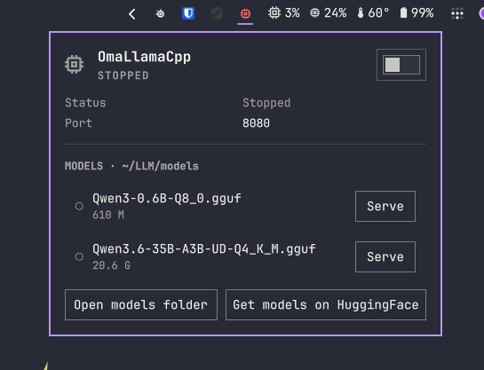
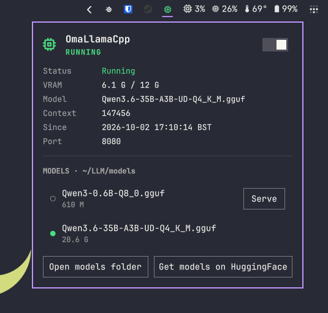

# ArggonLocalAI




An Omarchy shell bar widget for a local **llama.cpp `llama-server`**:
watch it from the bar, start/stop it as a **user systemd service** (no
sudo, no polkit), see VRAM use and the loaded model, and **switch models**
from the panel.

## Features

- **Bar icon** (Nerd Font chip): green = serving, red = offline (unit
  present but stopped), dim grey = binary or unit missing
- **Dropdown panel** with service status, VRAM, loaded model, context size
- **Start/Stop toggle** in the panel header; **right-click** the bar icon
  toggles, **middle-click** refreshes
- **Models list**: every `.gguf` in your models folder with a **Serve**
  button — pressing it rewrites the unit for that model and restarts the
  server (~10 s downtime while the new model loads)
- **Open models folder** (`xdg-open`, user-scope) and
  **Get models on HuggingFace** (opens the GGUF library in your browser;
  the plugin itself never downloads or executes anything)
- First start creates the configured models folder if missing

## Install

```sh
omarchy plugin add https://github.com/LinuxGamerUK/arggon.localai.git --enable
```

## Service setup

The plugin talks to a `llama-server.service` **user unit** it can create
for you: open the panel, pick a model, press **Serve**. The unit is
written to `~/.config/systemd/user/llama-server.service` (user-only, no
sudo), verified with `systemd-analyze verify`, then started.

### Building llama.cpp (example, pinned)

The plugin never builds or downloads llama.cpp itself — do that once,
yourself. One pinned block, checked out in detached mode before any
build (marketplace baseline rules):

```sh
# llama.cpp v0.5.0 — pinned commit, detached checkout BEFORE build
git clone https://github.com/ggml-org/llama.cpp && cd llama.cpp \
  && git checkout --detach d2e54583c7452353eb35d40431281f6ee984332f \
  && cmake -B build -DGGML_CUDA=ON \
  && cmake --build build --config Release -j$(nproc)
```

(Distropackaged builds work too — Arch has `llama.cpp-*` packages — as
long as the binary path matches the plugin's `binary` setting.)

### Getting a model (example, pinned)

Model files (`*.gguf`) go in your models folder (default
`~/LLM/models`). Direct download from a pinned revision:

```sh
curl -fL -o ~/LLM/models/Qwen3-0.6B-Q8_0.gguf \
  "https://huggingface.co/Qwen/Qwen3-0.6B-GGUF/resolve/23749fefcc72300e3a2ad315e1317431b06b590a/Qwen3-0.6B-Q8_0.gguf"
```

Browse the full library with the panel's **Get models on HuggingFace**
button (<https://huggingface.co/models?sort=trending&library=gguf>).

### The service unit (what gets written)

```ini
[Unit]
Description=llama.cpp OpenAI-compatible server (llama-server)

[Service]
Type=simple
ExecStart=<binary> --host 127.0.0.1 --port <port> -c <ctxSize> <extraArgs> -m <modelsDir>/<model>
Restart=on-failure
RestartSec=5
WorkingDirectory=$HOME

[Install]
WantedBy=default.target
```

## Usage

- **Click** the bar icon to open the panel
- **Toggle switch** to start/stop llama-server
- **Serve** button on any model row switches the served model: the unit
  is rewritten for that file and the service restarted (brief downtime
  while it loads)
- **Right-click** the bar icon toggles the service without the panel
- **Middle-click** refreshes

The panel shows: state (serving / offline), VRAM used/total, loaded
model + context size, uptime, port, and the `.gguf` models found in your
models folder with a green dot for the currently-served one.

Keyboard: `s` start · `x` stop · `r` refresh.

## Configure

```sh
# Refresh interval (default: 10 s)
omarchy bar set com.github.linuxgameruk.arggon.localai refreshIntervalSec 30

# Server port (default: 8080)
omarchy bar set com.github.linuxgameruk.arggon.localai port 8080

# Models folder (default: LLM/models, relative to $HOME unless absolute)
omarchy bar set com.github.linuxgameruk.arggon.localai modelsDir LLM/models

# llama-server binary (default: LLM/tools/llamacpp/llama-server)
omarchy bar set com.github.linuxgameruk.arggon.localai binary LLM/tools/llamacpp/llama-server

# Context size baked into the unit (default: 147456)
omarchy bar set com.github.linuxgameruk.arggon.localai ctxSize 8192

# Fixed model file (empty = first .gguf found alphabetically)
omarchy bar set com.github.linuxgameruk.arggon.localai modelFile ""

# Extra llama-server flags baked into the unit
omarchy bar set com.github.linuxgameruk.arggon.localai extraArgs "--flash-attn on"
```


## ROCm (nightly) backend (AMD GPUs)

ArggonLocalAI can drive a **ROCm-built** `llama-server` instead of the
Vulkan/CPU build. This is useful on AMD GPUs (e.g. RX 6700 XT / gfx1031)
where a nightly ROCm stack has native support for your architecture.

Configure (all user-scope, no sudo):

```sh
# Switch the service to the ROCm backend
omarchy bar set com.github.linuxgameruk.arggon.localai useRocm 1

# Path to your ROCm-built llama-server (relative to $HOME or absolute)
omarchy bar set com.github.linuxgameruk.arggon.localai rocmBinary LLM/tools/llamacpp-rocm/llama-server

# Optional: ROCm nightly lib folder added to LD_LIBRARY_PATH
omarchy bar set com.github.linuxgameruk.arggon.localai rocmLibPath /opt/rocm/lib

# gfx1031 handling:
#   - Empty (default) = native gfx1031 wheels (no override; recommended for
#     AMD nightly ROCm that ships gfx1031 code objects).
#   - Set to 10.3.0 for standard ROCm builds that need the gfx1030 masquerade.
omarchy bar set com.github.linuxgameruk.arggon.localai hsaOverrideGfxVersion ""

# Switch back to Vulkan/CPU
omarchy bar set com.github.linuxgameruk.arggon.localai useRocm 0
```

When `useRocm = 1`, the generated `llama-server.service` unit gains
`Environment=` lines (HSA override only if set, LD_LIBRARY_PATH only if set)
and `ExecStart` points at `rocmBinary` (falling back to `binary` when empty).
Press **Serve** on any model to rewrite and restart the unit.

Notes:
- Native gfx1031 wheels (AMD nightly) must NOT receive
  `HSA_OVERRIDE_GFX_VERSION` — it would hide the gfx1031 kernels.
- Standard ROCm (7.x) builds for gfx1031 still need `10.3.0` plus the
  flash-attention assert patch (see upstream llama.cpp issue #26702).
- The plugin never builds llama.cpp; build the ROCm binary yourself first.

## Backend dropdown

The panel now includes a **Backend** dropdown (Vulkan / CPU vs ROCm nightly)
that controls the `useRocm` setting via `omarchy bar set`. Switching backend
takes effect on the next **Serve** (the service unit is rewritten and
restarted for the chosen model).

## Remove

```sh
omarchy plugin remove com.github.linuxgameruk.arggon.localai
```

The created user unit and models folder are yours to delete:

```sh
rm ~/.config/systemd/user/llama-server.service
systemctl --user daemon-reload
```

## Requirements

- A `llama-server` binary you built yourself (see the pinned example above)
- systemd user services (every mainstream distro)
- NVIDIA GPUs get VRAM reporting via `nvidia-smi`; otherwise the field
  is simply hidden

## Privileges & security

- **None.** Everything is `systemctl --user` + writes inside your
  `$HOME` (`~/.config/systemd/user/`, models folder via `mkdir -p`).
  No sudo, no pkexec, no polkit.
- The plugin **never downloads or executes third-party code at
  runtime** — model/browser links are outbound only.
- All subprocess output is capped (`timeout -k 2 N` + `head -c` at the
  OS pipe + QML watchdog timers); external strings are sanitized and
  rendered as `Text.PlainText`.

## License

MIT
